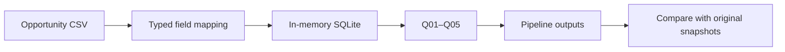
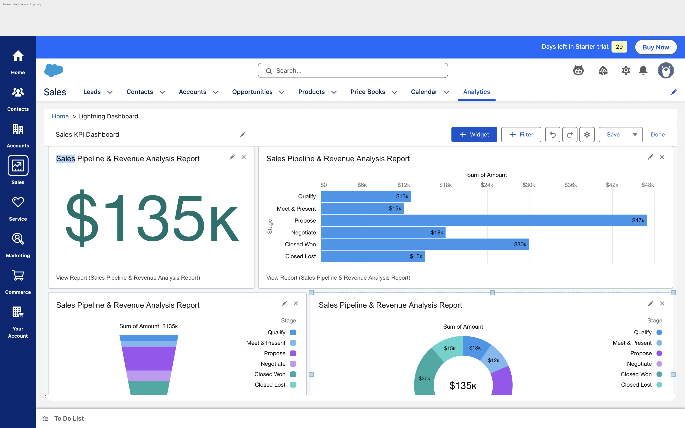

# Salesforce Pipeline Analytics

## Overview

This project examines a small opportunity-pipeline snapshot using SQL, supplemented by historical Salesforce report screenshots and business-analysis documentation. Its purpose is to distinguish open pipeline, probability-weighted opportunity amounts and closed outcomes without treating them as interchangeable revenue measures. A standalone Python runner loads the supplied ten-row CSV into SQLite, executes the existing SQL queries and validates every result against preserved output snapshots. The folder includes requirements, scenario commentary and illustrative delivery registers, but it does not include Salesforce metadata exports, Apex, a configured Salesforce org or a working API connector. The screenshots are historical presentation evidence; their displayed amounts are not assumed to reconcile with the current CSV. Findings are deliberately limited to the available snapshot.

## Business problem and objectives

Revenue discussions can become misleading when closed deals are included in open pipeline or probabilities are presented as booked revenue. The objectives are to reconcile all-record totals, separate open/closed populations, rank review candidates and flag invalid stage probabilities.

## Technology stack

Python standard library and SQLite SQL for local analysis; CSV inputs and output snapshots; Salesforce screenshots for historical report examples; Markdown and planning registers. No Salesforce SDK or deployment tooling is required for the local queries.

## Dataset

[pipeline.csv](Data/pipeline.csv) contains **10 opportunities** and four fields: `Opportunity`, `Stage`, `Amount`, `Probability`. IDs are sample letters. There are no close dates, historical transitions, owners, activity history or verified currency metadata. USD is the original portfolio assumption. The file cannot support sales velocity, conversion trends or forecast-accuracy claims.

## Architecture and workflow



## Data processing and analytical logic

Required values and numeric parsing are checked without changing the CSV. Q01 computes total and weighted amounts; Q02 separates open opportunities from Closed Won and Closed Lost; Q03 aggregates stages; Q04 ranks the open review queue; Q05 flags probabilities outside 0–1 or inconsistent with closed stages. Weighted pipeline is `SUM(amount × probability)`, a scenario estimate rather than realized revenue. The original `SQL/analysis.sql` and combined query pack remain alongside the numbered queries.

## Reporting and verified findings

Recomputed from [the supplied SQL](SQL/) and reconciled with [result snapshots](Analysis/RESULTS.md):

| Metric | Amount |
| --- | ---: |
| All-record amount | $164,000 |
| All-record weighted amount | $83,550 |
| Open pipeline | $119,000 |
| Weighted open pipeline | $53,550 |
| Closed Won | $30,000 |
| Closed Lost | $15,000 |

Eight open opportunities are returned. Opportunity D has the largest weighted open amount ($13,500). No stage-probability exceptions appear in this small snapshot. These observations are not evidence of improved sales performance.

## Screenshots



This historical dashboard displays approximately $135K and is **not** the same reconciled population as the $164K CSV. It is retained as interface evidence only. Browser/CRM UI and original workspace ownership must not be attributed to a newly deployed application.

## Project structure

```text
Data/         opportunity snapshot
SQL/          numbered queries and original query packs
scripts/      runner, source mapping and validator
Analysis/     preserved outputs and commentary
Images/       historical Salesforce screenshots
Docs/         requirements and specifications
Delivery/     illustrative planning and UAT records
Jira/         relevant historical planning screenshot
Case_Study/   inherited case-study narrative
Modeling/     scenario-analysis notes
```

## Installation and execution

Python 3.10+ with SQLite 3.25+ is sufficient for the local analysis. No third-party Python packages, API keys or cloud services are required.

```sh
python3 scripts/run_analysis.py
python3 scripts/validate.py
```

Run from this project directory. Input paths are resolved from the script location, so execution also works from another working directory. Results are written to ignored `artifacts/`; the supplied `Analysis/` snapshots remain unchanged. The validator compares every Q01–Q05 output field against those snapshots. See [the runbook](Docs/09_Operations_Runbook.md) for failure handling.

## Validation and limitations

All five supplied SQL queries were executed and reconciled locally. Source CSVs are preserved; ingestion validates required columns, numeric types and finite values. This is snapshot reconciliation, not proof of real-world accuracy or stakeholder approval. See [audit results](AUDIT.md).

The original documentation describes a shared Local_System web application, role controls, persistent UAT and transaction history. That application was **not supplied** in this extracted folder. It is not represented as an implemented feature of this standalone copy. Delivery records, proposed approvals and UAT examples remain historical portfolio artifacts. Native application behavior and external integrations require separate testing.

## Attribution and license

The supplied materials identify **Jamie Christian** as their original portfolio author. That authorship, document credits and historical planning evidence are retained. This cleaned copy is prepared for `amrut-mdsh`; it does not claim exclusive authorship or production deployment. No LICENSE was supplied. Public redistribution rights for code, data, dashboards and screenshots must be confirmed separately; see [ATTRIBUTION.md](ATTRIBUTION.md).

## Future improvements

Add authorized close-date/stage-history extracts, reconcile screenshots to a documented snapshot and validate native Salesforce report definitions before extending the analysis.
